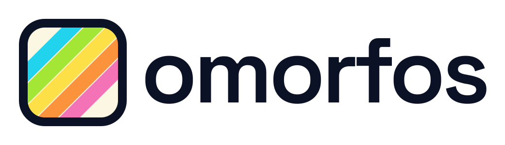

# omorfos

<picture>
  <source media="(prefers-color-scheme: dark)" srcset="docs/brand/lockup.svg">
  
</picture>

A Wayland desktop for Linux, written in Rust: small, fast, driven by text
files, with windows that can share a frame as tabs, and growing into a
whole desktop with a modern look. *omorfos* is Greek for "beautiful".

It means to add nothing to the ways a Linux desktop already has of doing
one thing: it speaks the standards there are, and where there is none it
[says so](docs/STANDARDS.md) and takes the question to those who could
agree one.

> **Status:** early development, and not released yet. It runs as the
> session you log in to, on real hardware, but has been tried on very
> few machines. Expect rough edges and changing defaults. What is done and what is next is in
> [docs/ROADMAP.md](docs/ROADMAP.md).

## What there is

- **Windows** with titlebars drawn by omorfos: close, minimize and
  fullscreen buttons at the left, a menu on a right click, tabs, rounded
  corners, shading, keeping above, and showing on every workspace; or
  left to draw their own, for programs that do.
- **A look of glass**: bars, menus and titlebars blur what is behind
  them, in a light and a dark scheme that can follow the sun, with one
  accent colour. `reduce_transparency` makes it all solid.
- **Arranging windows**: drag one to an edge for a half or a quarter of
  the screen, or pick a layout from its titlebar; an overview of every
  window, and a switcher on `Super+Tab`.
- **Workspaces made as you need them**, per screen, and gone when they
  are empty. A fullscreen window gets one to itself; rest the pointer
  against the top of the screen to get its titlebar back.
- **A panel and notifications**, each a small program of its own,
  started again if it stops, and **a launcher**, started when it is
  asked for; each replaceable by any other.
- **A lock screen**, a box that asks for passwords that no other program
  can imitate, and the session locked before the machine sleeps.
- **Screenshots and screen sharing**: of every screen, a window or a
  region, and shared in a browser or a call through the portal, with a
  line round what is shared.
- **A session that outlives its compositor**: programs stay open while
  omorfos is started again, and a new version is taken up without
  logging out.
- **Programs written for X11**, through Xwayland, with the clipboard
  shared both ways.
- **Text files for everything**, in `~/.config/omorfos/`: settings and
  keys in YAML, the look in CSS. They are read again the moment they are
  saved, and a mistake in one is reported on screen and never takes the
  session down.
- **Several screens**, each at its own scale, fractional scales included.
- **A socket to script it by**, with `omorfosctl`.

## What it holds to

- **Secure.** No `unsafe` in our own code but for the buffers of
  PipeWire's streams, kept in a crate of their own; every program, every peer on
  the socket and every configuration file is treated as untrusted.
- **Correct.** Every line is covered by a test, outside the few files
  that cannot run in CI, each listed with its reason in
  [ADR 2](docs/adr/0002-coverage-policy.md). The compositor is tested through a
  real Wayland client, looking at the pixels it draws.
- **Fast.** Nothing is drawn when nothing changes.
- **Lean.** The compositor manages windows. What can be a program of its
  own is one.
- **Not only for omorfos.** The lock screen, the wallpaper, the
  clipboard keeper and the applications to come are to run on other
  compositors too, each packaged and versioned by itself
  ([ADR 98](docs/adr/0098-which-programs-stand-alone.md)).

Linux on `x86_64` and `aarch64`.

## Trying it

Build it, then run it from inside the desktop you already use. It opens
in a window and prints the name of its socket:

```sh
cargo run -p omorfos
```

Start a program inside it with, for example, `WAYLAND_DISPLAY=wayland-1
foot`. Key bindings that use Super may be taken by the host desktop
before they reach the window.

To use it as your session, build it, install the programs, the entry a
login screen reads and the lock screen's PAM services, then pick omorfos
when you log in:

```sh
make
sudo make install
```

The programs go in `/usr/local/bin`, or wherever `PREFIX` says; what
login screens, the portal and systemd read goes where they look for it.
`install` builds nothing, so build first as yourself, and it keeps the PAM
services in `/etc/pam.d` if they are there already. `sudo make uninstall`
takes it all away but those.

It can also be started from a text console by running `omorfos`.
`Ctrl+Alt+F1` to `F12` switch virtual terminal.

A few keys to begin with:

| Key | Does |
|---|---|
| `Super+Return` | A terminal (`foot`) |
| `Super+Space` | The launcher |
| `Super+Escape` | The menu |
| `Super+Tab` | The window before, or hold Super to choose one |
| `Super+q` | Close the window |
| `Super+m` | Maximize the window, and back |
| `Super+h` | Hide the window |
| `Super+Ctrl+f` | Fullscreen, and back |
| `Super+Ctrl+n` | A new workspace |
| `Super+1` to `Super+9` | Go to a workspace |
| `Print` | A picture of every screen, saved in `Pictures/Screenshots` |
| `Shift+Print` | Pick a window, a screen or a region, on the clipboard |
| `Alt+Print` | A picture of the window with focus |
| `Super+Shift+r` | Read the configuration again |
| `Super+Shift+e` | End the session |

Everything else, and how to change any of it, is in the guide,
[docs/guide/](docs/guide/README.md), which begins with your first login.

## What it needs

To build: Rust (the version is pinned in `rust-toolchain.toml`),
`pkg-config`, `clang`, and the development files for libxkbcommon, pixman,
udev, libinput, libseat, GBM, PipeWire (1.4 or later) and PAM. On Debian 13,
or Ubuntu 25.10 and later:

```sh
sudo apt install pkg-config libxkbcommon-dev libpixman-1-dev libudev-dev \
  libinput-dev libseat-dev libgbm-dev libpipewire-0.3-dev libpam0g-dev \
  libclang-dev clang
```

`make` also gathers the licences of the crates it is built from, for the
packages to carry, with cargo-about:

```sh
cargo install --locked --features cli cargo-about@0.9.3
```

To run: EGL and OpenGL ES (`libegl1 libgles2`), and a seat from logind or
seatd. The rest is wanted, and done without if it is not there:

| | For |
|---|---|
| `Xwayland` | Programs written for X11 |
| `foot` | The terminal the default keys start |
| Inter and JetBrains Mono (`fonts-inter`, `fonts-jetbrains-mono`) | The fonts of the design; without them the system's `sans-serif` and `monospace` are used |
| The Adwaita icons (`adwaita-icon-theme`) | The icons programs name without bringing their own |
| A D-Bus session, and `dbus-update-activation-environment` | Notifications, and telling D-Bus and systemd of the session |
| `xdg-desktop-portal` | Applications following the look of the desktop, and asking for screenshots |
| `xdg-desktop-portal-gtk` | Choosing files, which omorfos leaves to it |
| `gdbus` (`libglib2.0-bin`) | Starting the portal at login once omorfos's own part of it is there |
| PipeWire, 1.4 or later | Sharing the screen in a browser or a call |
| `wpctl` (WirePlumber) | The volume keys |
| `wl-copy` and `wl-paste` (`wl-clipboard`) | Copying and pasting in an editor in a terminal, such as Neovim, which otherwise goes through X11 and cannot read what programs written for Wayland copy |
| The list of PCI devices (`pci.ids`; `hwdata` on Arch and Fedora) | Naming the graphics card in "About"; without it, its numbers |

To run the tests as well: `dbus-daemon`, `pipewire`, and `Xwayland`,
which needs `libEGL`; `setpriv` (`util-linux`), which stops a test's
own bus and PipeWire with the test however it ends; `pam_wrapper` (`libpam-wrapper`), which the lock
screen's tests ask PAM through; and the DejaVu fonts to draw as CI does.
The tests of real programs kept through a change of compositor, run by
hand and in CI, try those of `foot`, `zenity`, Firefox ESR and Telegram (a
Flatpak) that are installed, and pass over the rest (docs/TESTING.md).

## Documentation

| | |
|---|---|
| [docs/guide/](docs/guide/README.md) | The first login, every setting, key, rule and part of the theme, how to use the desktop, and what to do when something is wrong |
| [man/](man) | The manual pages, made from each program's `--help` and the files' schemas: `man omorfos` and `man 5 omorfos-config` once installed |
| [docs/IPC.md](docs/IPC.md) | The socket and `omorfosctl`: scripting, and writing your own panel |
| [docs/ROADMAP.md](docs/ROADMAP.md) | What is done, what is next, and in what order |
| [docs/DESIGN.md](docs/DESIGN.md) | What it is to look like, and the rules a part is drawn by |
| [docs/ARCHITECTURE.md](docs/ARCHITECTURE.md) | How the code is laid out |
| [docs/adr/](docs/adr/) | Each decision that shaped it, and why |
| [docs/](docs/README.md) | Every document there is, by who it is for |
| [crates/](crates/README.md) | What each program and library is |
| [CREDITS.md](docs/CREDITS.md) | Whose work it is drawn with |
| [ACCESSIBILITY.md](docs/ACCESSIBILITY.md) | What there is for those who see, move or read differently, what is not there yet, and how to say |
| [SECURITY.md](docs/SECURITY.md) | How to report a vulnerability, privately |

## Working on it

[CONTRIBUTING.md](docs/CONTRIBUTING.md) says how to help and what a change is
held to, and everyone taking part follows the
[code of conduct](docs/CODE_OF_CONDUCT.md). [AGENTS.md](AGENTS.md) is the
place to start on the code, for people as much as for agents, and
[docs/TESTING.md](docs/TESTING.md) says how things are tested, and
the gates every change passes before it goes in. Commits follow
[Conventional Commits](https://www.conventionalcommits.org/en/v1.0.0/),
and releases are made from them: see
[docs/RELEASING.md](docs/RELEASING.md).

## License

[MIT](LICENSE)
